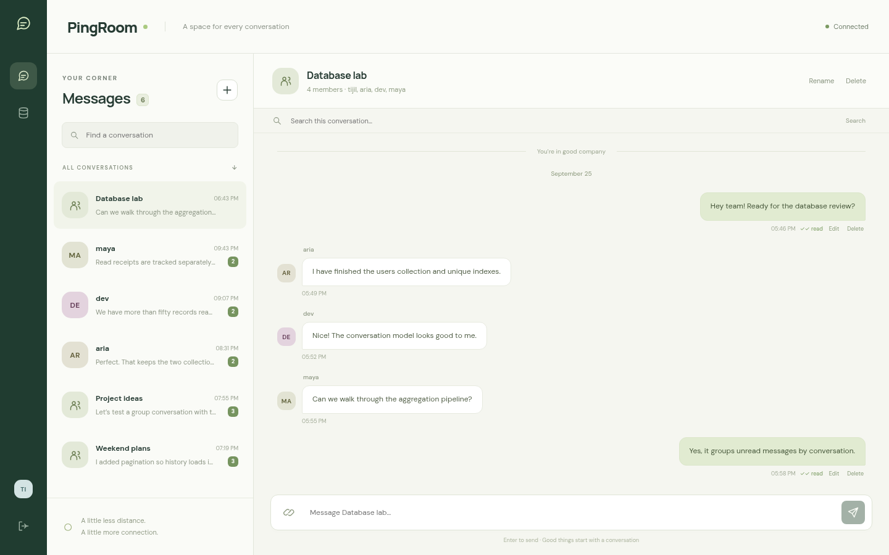

# PingRoom

A self-hosted MERN chat application for direct and group conversations, with a live MongoDB Database Studio for explaining the database implementation.



## Run the final implementation

Requirements: **Node.js 22.12+**, npm, and Docker with Compose. Docker must be running.

```bash
npm ci
npm run setup
npm start
```

Open **http://localhost:3100**. Setup generates a random JWT secret in a local `.env`, starts MongoDB as replica set `rs0`, seeds an empty database, and builds React. Existing data is preserved.

Demo accounts: `tijil@vitstudent.ac.in` and `aria@vitstudent.ac.in`, both using `PingRoom@123`. Use separate browser profiles or an incognito window for two users. These are synthetic demonstration accounts, not real credentials.

## Features

- Registration and login, bcrypt password hashing, expiring JWTs, profile updates and password-confirmed account deletion.
- Direct conversations with a unique pair key, groups of 3–50 participants, owner-only rename and deletion.
- Persistent text messages, HTTP(S) attachment links, author-only edit/delete and conversation search.
- Socket.IO message events, typing and online presence, including multiple tabs.
- Per-recipient delivery/read receipts. A group message is read only when every participant is in `readBy`.
- Stable cursor pagination with `(createdAt, _id)` and a matching compound index.
- Transactions keep message records and cached conversation previews consistent.
- Database Studio: global counts, membership-scoped aggregations, index definitions and live query execution statistics.
- Responsive interface and keyboard navigation for dialogs.

## Verification

```bash
npm run build
npm run format:check
npm test
npx playwright install chromium
npm run test:ui
```

For a system Chrome installation: `CHROME_PATH=/usr/bin/google-chrome npm run test:ui`.
The API suite creates and drops its own uniquely named test database. Browser tests use the seeded demo app and remove the messages they create on successful completion. CI performs setup, build, formatting, API tests and browser tests.

## Development

Run `npm run dev:server` in one terminal and `npm run dev` in another. Vite proxies HTTP and Socket.IO to `PORT` from `.env` (3100 by default). `npm start` serves the built frontend and API together.

| Setting | Purpose |
| --- | --- |
| `MONGODB_URI` | Replica-set connection string; local default is in `.env.example` |
| `JWT_SECRET` | Random secret of at least 32 characters; never commit `.env` |
| `PORT` | API and production frontend port, default 3100 |
| `HOST` | Listening interface, default loopback |

`npm run db:stop` stops MongoDB without deleting the Docker volume. `npm run db:up` starts it again. Do not remove the volume before the demonstration.

## Project map

| Path | Responsibility |
| --- | --- |
| `server/models.js` | Mongoose documents, references and indexes |
| `server/app.js` | Validation, auth, API routes, transactions, aggregation |
| `server/realtime.js` | Authenticated Socket.IO events and connection counts |
| `server/index.js` | Database connection, static frontend, startup and shutdown |
| `client/src/main.jsx` | Chat state, API calls, socket listeners and conversation UI |
| `client/src/components/` | Authentication, attachment form and Database Studio |
| `scripts/seed.js` | Transactional synthetic sample dataset |
| `tests/` | API/database tests and Playwright browser tests |
| `docs/` | API reference, code walkthrough and demonstration checklist |
| `output/` | Final review report and pitch deck, plus historical Review 2 files |

## Final review materials

- [Final review paper](output/PingRoom_Final_Review.pdf)
- [Editable report](output/PingRoom_Final_Review.docx)
- [Pitch deck](output/PingRoom_Final_Pitch.pptx)
- [Code walkthrough](docs/CODE_WALKTHROUGH.md)
- [Demo checklist](docs/DEMO.md)
- [API reference](docs/API.md)

## Scope and honest limitations

This is a complete local classroom implementation of the reviewed text-chat scope. Attachments are externally hosted links, not uploaded files. The local MongoDB replica set has **one member**: it enables transactions but does not provide failover. Sharding, multiple application servers, end-to-end encryption, calls, password recovery and file storage are future work. The 300 ms latency goal from Review 1 has not been load-tested. Socket events are transient; reconnecting fetches persisted history. Session tokens live in sessionStorage and expire after one day; logout removes the local token, without server-side token revocation.

Before an internet deployment, configure HTTPS, replace demo accounts, restrict Database Studio, plan backup/restore, and provision a managed replica set. Global collection counts and index metadata are intentionally visible to authenticated users in this teaching app.

## License

ISC, as declared in `package.json`. See [LICENSE](LICENSE).
